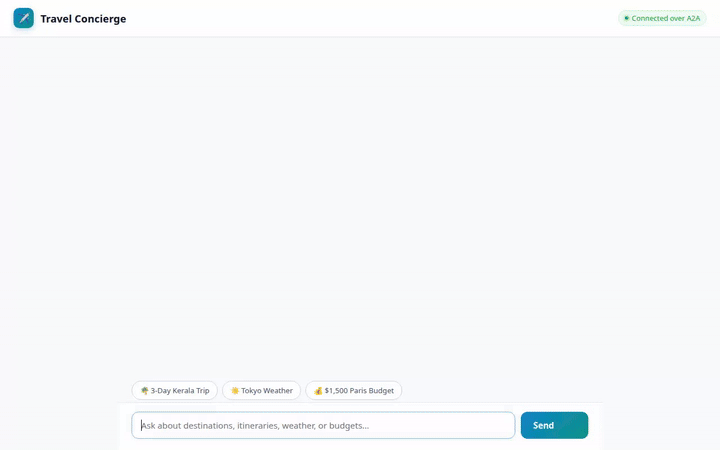

# ✈️ Travel Concierge Agent

An intelligent, multi-modal AI travel assistant built with Google's Agent Development Kit (ADK). Travel Concierge helps users discover destinations, build detailed itineraries, compute trip budgets, search nearby attractions, and generate custom visual imagery and video previews.



---

## ✨ Features & Capabilities

The agent is powered by **Gemini 2.5 Flash** with a rich set of integrated tools and Google Cloud services:

* **🧠 Cross-Session Long-Term Memory (Vertex AI Memory Bank)**: Automatically remembers user travel styles, dietary needs, budget levels, and top favorite destinations (such as Kerala, India) across sessions using `VertexAiMemoryBankService` and `PreloadMemoryTool`.
* **🗄️ Destination Catalog (Google Cloud Firestore)**: Queries and adds curated destination entries (`get_destinations`, `add_destination`) directly in Firestore.
* **🖼️ AI Image Generation**: Generates scenic travel imagery using `gemini-3.1-flash-lite-image` in the global region (`generate_destination_image`).
* **🎬 AI Video Generation**: Generates short promotional or scenic travel clips using Google's Omni model (`gemini-omni-flash-preview`) in the global region (`generate_destination_video`).
* **☁️ Public Cloud Storage Asset Host**: Automatically uploads generated images and videos directly to a public Google Cloud Storage bucket (`travel-concierge-public-qwiklabs-gcp-02-547b57b57d29`).
* **🎨 Structured A2UI Cards**: Emits rich A2UI Basic Catalog cards (v0.8) via an `after_model_callback` for elegant rendering in web interfaces.
* **📍 Google Maps Places & Geocoding**: Looks up location coordinates (`geocode_address`) and discovers nearby points of interest (`search_nearby_places`) using the Google Maps Platform API.
* **🌐 Live City Data & Exchange Rates**: Fetches live weather and time (`get_live_city_info`), real-time currency exchange rates (`get_live_exchange_rates`), and public holiday schedules (`get_public_holidays`).
* **💰 Itemized Trip Budgeting**: Calculates itemized travel breakdowns including lodging, food, transport, activities, and contingency buffers (`calculate_trip_budget`).
* **💻 Sandboxed Code Execution**: Executes custom Python code in an isolated `AgentEngineSandboxCodeExecutor` for complex calculations and data processing.

---

## 🛠️ Project Structure

```
travel-concierge/
├── app/
│   ├── __init__.py
│   ├── agent.py            # Main ADK agent configuration & A2UI instructions
│   ├── a2ui_utils.py       # A2UI callback for extracting card JSON payloads
│   ├── firestore_tools.py  # Firestore destination database tools
│   ├── image_tools.py      # Image generation & GCS upload tool
│   ├── video_tools.py      # Omni video generation & GCS upload tool
│   ├── maps_tools.py       # Google Maps Geocoding & Places tools
│   ├── api_tools.py        # Live city info, exchange rates, & public holidays
│   └── app_utils/          # Telemetry & service helpers
├── frontend/
│   ├── main.py             # FastAPI A2A proxy server
│   ├── static/index.html   # Rebranded Travel Concierge chat UI with A2UI renderer
│   └── Dockerfile          # Dockerfile for Cloud Run deployment
├── agents-cli-manifest.yaml# Agent project configuration
└── demo.gif                # Inline demo recording GIF
```

---

## 🚀 Local Setup & Running Instructions

### Prerequisites
- Python 3.11+
- Google Cloud SDK (`gcloud`) authenticated to your GCP project
- Active Google Maps API key (for Maps tools)

### 1. Install Dependencies
```bash
# Install agent dependencies
pip install -r requirements.txt

# Install frontend dependencies
cd frontend
pip install -r requirements.txt
cd ..
```

### 2. Run Agent Playground (Local ADK Web UI)
To start the ADK Playground developer interface:
```bash
adk web --port 8000
```
Open your browser and navigate to the local dev UI at port `8000`.

### 3. Run the Custom FastAPI Frontend Locally
Set your deployment resource name and agent directory, then start the proxy server:
```bash
cd frontend
export AGENT_ENGINE_RESOURCE_NAME="projects/<PROJECT_NUMBER>/locations/<REGION>/reasoningEngines/<REASONING_ENGINE_ID>"
export AGENT_DIRECTORY="app"
python main.py
```
Open your browser and navigate to port `8080`.

---

## ☁️ Deployment

### Deploying the Agent to Agent Platform
```bash
agents-cli deploy \
  --project=<YOUR_PROJECT_ID> \
  --region=us-east1 \
  --update-env-vars GOOGLE_MAPS_API_KEY=<YOUR_MAPS_API_KEY>
```

### Deploying the Frontend Proxy to Cloud Run
```bash
cd frontend
gcloud run deploy travel-concierge-frontend \
  --source . \
  --region us-east1 \
  --project <YOUR_PROJECT_ID> \
  --set-env-vars AGENT_ENGINE_RESOURCE_NAME="<YOUR_REASONING_ENGINE_RESOURCE_NAME>",AGENT_DIRECTORY="app" \
  --allow-unauthenticated
```
